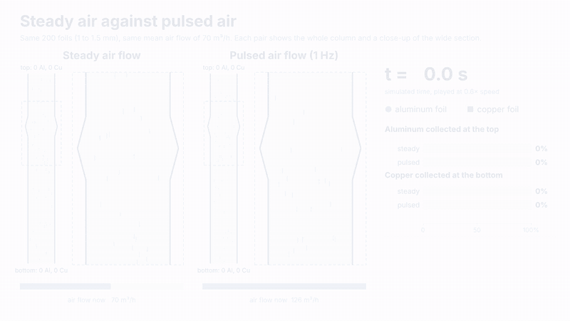

# Pneumatic Particle Separation in a Variable-Diameter Pulsed-Airflow Separator

A particle-level model of the pulsated pneumatic separator of Zhu et al. (2021), which separates the aluminum and copper foils of crushed lithium-ion batteries. Air flows upward through a column with a variable-diameter section. Aluminum leaves at the top and copper falls to the bottom.

## What is in this repository

| File | Content |
|---|---|
| `Project_Check_In_Final_Project.ipynb` | The project notebook with the model, the code and all results |
| `separator_animation.mp4` | Short video (52 s) that explains the separator, shows 200 foils in steady and in pulsed air flow at 70 m³/h, and compares the model with measurements |
| `separator_animation.gif` | The simulation part of the video, shown above |

## The model in brief

- Force balance on each foil with drag, gravity, buoyancy, pressure-gradient force and added mass (Li et al., 2023).
- Drag law for foils from the equivalent diameter method of Zhu et al. (2021), checked against their measured suspension velocities.
- Prescribed air flow rate with an optional pulsation, a one-seventh power-law velocity profile across the pipe with the radial velocity required by continuity, and turbulent fluctuations scaled with the friction velocity.
- Multi-particle simulation with hard-sphere collisions and wall reflection, written in JAX.
- Recovery and grade of both products against air flow rate, compared with the measurements of Zhu et al.

## How to run

Open the notebook in Google Colab and choose Runtime > Run all. It needs only NumPy, SciPy, pandas, Matplotlib and JAX, which Colab provides. The run takes about 11 minutes on Colab's CPU runtime.

## References

Zhu, X.; Zhang, C.; Feng, P.; Yang, X.; Yang, X. A Novel Pulsated Pneumatic Separation with Variable-Diameter Structure and Its Application in the Recycling Spent Lithium-Ion Batteries. *Waste Management* 2021, 131, 20–30.

Li, D.; Wang, L.; Wei, L.; Qu, Q.; Wang, J. A Study of the Dynamic Mechanism in Low-Rank Coal Separation with Varying-Diameter Pulsed Airflow Separator. *Coal Preparation Technology* 2023, 51 (2), 9–13.

The full reference list is in the notebook.
